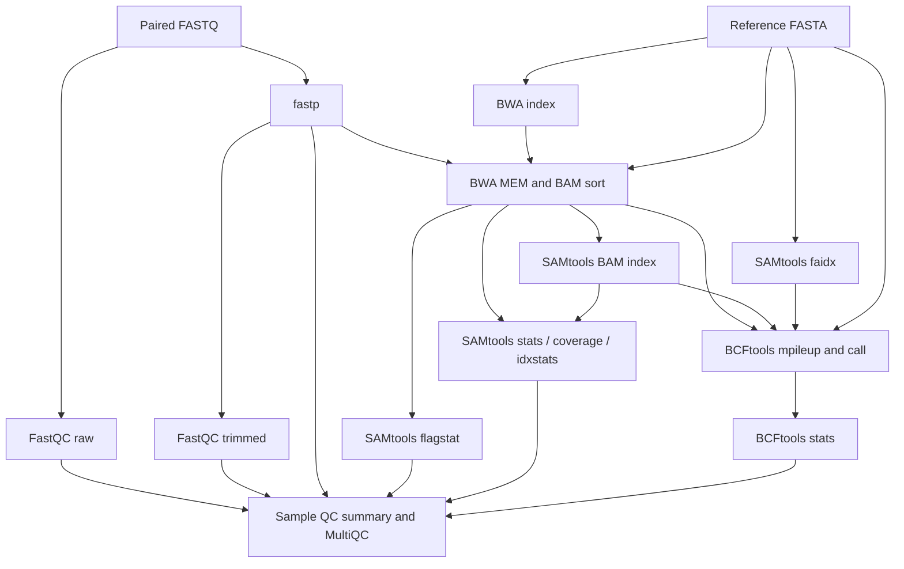

# Varcall

A small DSL2 Nextflow workflow for paired-end read QC, BWA-MEM alignment and BCFtools variant calling. Based on the [Nextflow course template](https://github.com/glebus-sasha/nextflow-course-template).

## Workflow



## Requirements and run

Test environment: Linux, Nextflow 25.10.4, Java 17, Apptainer 1.5.3, Python 3.9+ (host-side verification), Bash and GNU coreutils. Use the bundled training data (`data/*_R{1,2}.fastq.gz`, `data/MT.fna`). No cluster-specific paths are required in the workflow. From the repository root:

```bash
bash scripts/prepare_local_qc.sh
bash scripts/run_qc.sh
```

The preparation script reuses existing SIFs, downloads only missing ones, checks executable versions and writes an ignored local configuration. The run script uses `-resume` and puts Nextflow execution metadata in a unique ignored directory. For direct use with the public module container URIs:

```bash
nextflow run main.nf -profile apptainer
```

For alternate inputs: `nextflow run main.nf -profile apptainer --reads 'mydata/*_R{1,2}.fastq.gz' --reference myref.fa`. The release validation and provided verifier target the bundled six samples; adapt them for different inputs.

## Tools

| Tool | Validated executable version | Image source |
|---|---|---|
| BWA + SAMtools | 0.7.17-r1188 / 1.13 | `glebusasha/bwa_samtools:latest` (original course image) |
| fastp | 0.23.1 | `nanozoo/fastp:0.23.1--9f2e255` |
| FastQC | 0.12.1 | Galaxy SIF `fastqc-0.12.1--hdfd78af_0` |
| SAMtools QC | 1.20 | `quay.io/biocontainers/samtools:1.20--h50ea8bc_0` |
| BCFtools | 1.25 | `staphb/bcftools:1.25` |
| MultiQC | 1.35 | `staphb/multiqc:1.35` |

`containers.sha256` records the exact local SIF bytes used for a validated run (verify against the original binaries from the container directory). These hashes are not registry manifest digests, and independently rebuilt SIF files may differ. Version tags are mutable; the combined course image remains unversioned upstream. The preparation script checks program versions, not upstream immutability. For exact binary reproducibility, retain the original six SIFs separately. Do not commit them.

## Results

- `results/fastqc/raw/` and `results/fastqc/trimmed/`: HTML and ZIP files for both mates.
- `results/qcontrol/`: fastp outputs including JSON.
- `results/align/` and `results/bamindex/`: coordinate-sorted BAM and BAI.
- `results/flagstat/`, `results/samtools_stats/`: mapping statistics, coverage and idxstats.
- `results/varcall/`, `results/bcfstats/`: VCFs and BCFtools statistics.
- `results/report/multiqc_report.html`: unified report with a separate sample-level QC table and separate raw/trimmed FastQC sections.
- `results/report/sample_qc.tsv`: one row per paired-end sample, calculated from source logs. Q30 is a fraction of bases, mapped percentage is from SAMtools stats, coverage is the fraction of reference positions covered. VCF counts are unfiltered. `multiqc_data/` contains underlying plot tables.

## Validation

```bash
python3 -m unittest discover -s tests -p 'test_*.py'
python3 scripts/verify_qc.py
bash scripts/validate_release.sh
```

The last script uses a fresh isolated launch/work/results directory, checks 57 completed tasks and 60 original QC inputs, then repeats with `-resume` and requires 57 cached tasks and unchanged VCF/summary checksums. This checks execution and caching, not biological variant truth. Release validation passed on 2026-11-24: 57 completed tasks in a fresh run, 57 cached tasks on resume, 60 QC input files, and unchanged checksums for all six VCF files and the sample QC summary.

## Scope and limitations

The bundled reference is mitochondrial only. Mapping rates are relative to this reference; high MAPQ against MT alone does not exclude nuclear mitochondrial sequences. This is a training workflow, not a clinical pipeline: the original BCFtools calling model is not tuned for mitochondrial heteroplasmy; there is no dedicated variant filtering or truth-set validation. Incomplete coverage and circular-reference effects require additional analysis in real studies. No sample-specific thresholds are imposed by the report.

Do not publish private inputs, raw execution logs, local configuration, SIFs, or generated reports (which can contain absolute paths). Review the origin and licensing of the bundled training data before public distribution.
